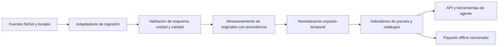
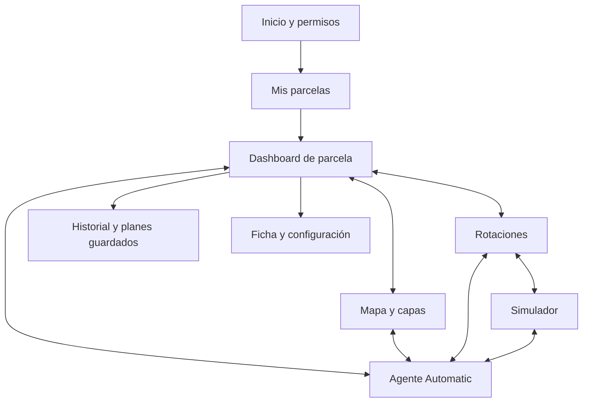
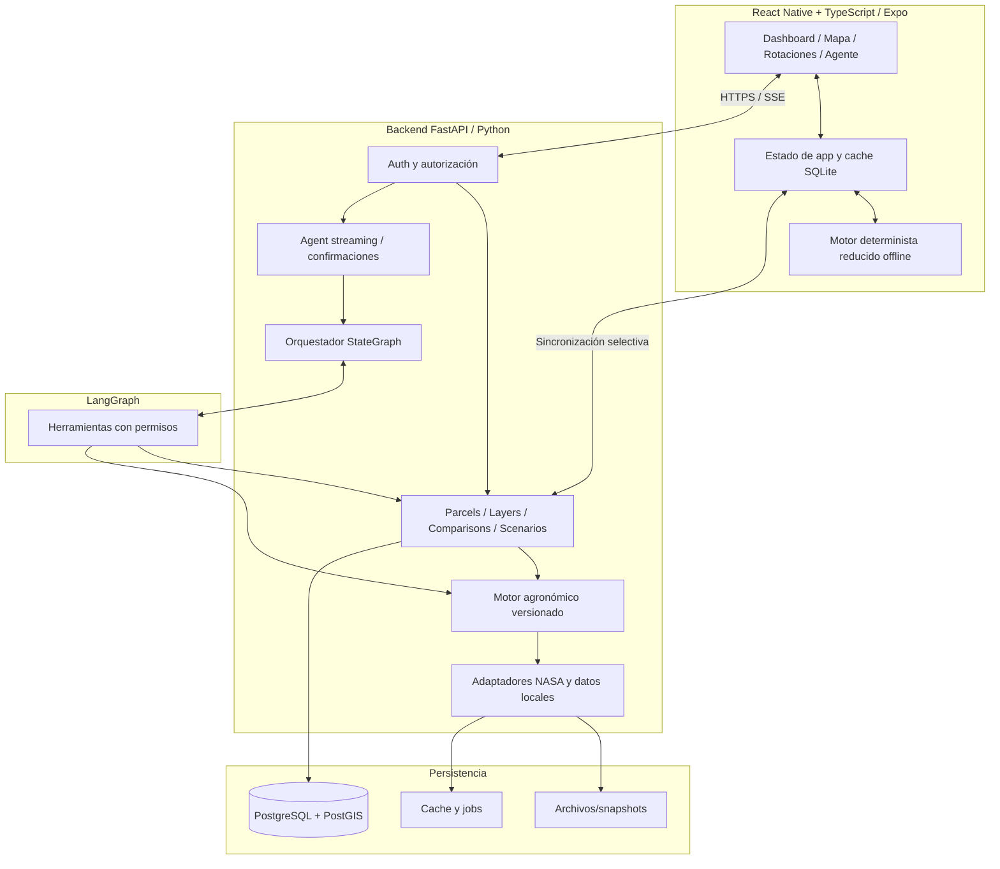
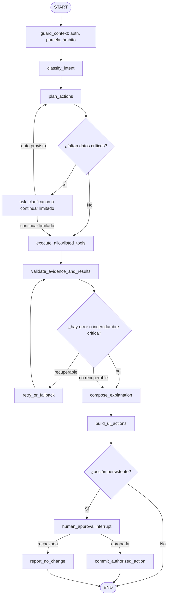
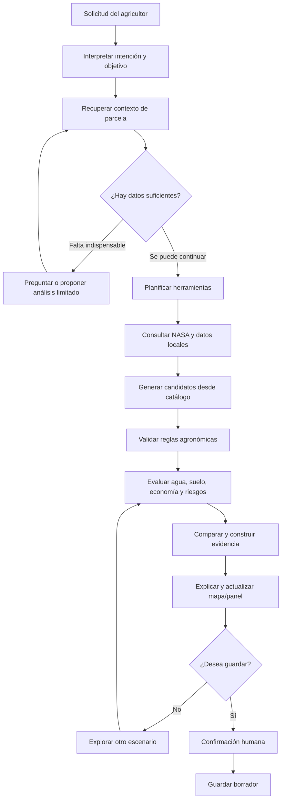

# AUTOMATIC
## Plan maestro de producto, experiencia agrícola, arquitectura y agente geoespacial

**Nombre del producto:** Automatic  
**Descriptor:** Copiloto inteligente de planificación agrícola geoespacial  
**Lema:** *Tu parcela, tus decisiones, más información.*  
**Proyecto:** Team Automatic · NASA Space Apps Challenge 2026  
**Reto:** *Field Shift: Adapting Farms with NASA Data*  
**Piloto:** Moquegua, Perú  
**Versión:** 2.0 · Propuesta integral revisada · 14 de noviembre de 2026  
**Stack acordado:** React Native + TypeScript (aplicación), FastAPI + Python (API), LangGraph (orquestación del agente).

> **Estado del documento:** propuesta de diseño, no especificación de un sistema ya implementado. Los nombres de funciones, rutas, tablas, datos de muestra y umbrales son contratos propuestos. Los cultivos de ejemplo son hipótesis que requieren validación local. No se afirma que una conexión, API, extracción satelital o recomendación ya funcione.

---

# 0. Resumen ejecutivo

**Automatic** será una aplicación móvil agrícola con dos experiencias simultáneas: (1) un **panel de control** que sintetiza la situación de la parcela y permite simular decisiones; y (2) un **mapa geoespacial** con capas satelitales y ambientales. Ambas se conectan mediante un **agente de IA construido con LangGraph**: el agricultor puede pedir al agente que investigue el contexto de su parcela, active capas, compare opciones de rotación y explique sus resultados. El agente **no inventa mediciones ni sustituye los cálculos**: invoca herramientas deterministas que recuperan y procesan datos con procedencia auditable.

**Propuesta de valor:** “En una sola aplicación, veo qué ocurre en mi terreno, comprendo los riesgos y comparo qué sembrar después de acuerdo con el agua, el suelo, el clima y mi realidad económica”.

**Promesa comprobable del MVP:** en una parcela piloto, registrar información básica, visualizar su contexto espacial, consultar datos NASA con metadatos, comparar la rotación existente con dos candidatas en un horizonte equivalente, evaluar agua, suelo y economía con sus límites, disminuir agua o precio con controles separados y obtener una explicación comprensible de riesgos y datos faltantes. El usuario puede guardar la alternativa **como borrador sujeto a verificación**, nunca como prescripción agrícola certificada.

**Decisión arquitectónica:** un agente orquestador + herramientas, NO cuatro LLM independientes. FastAPI aloja las herramientas y servicios de dominio; LangGraph decide el flujo conversacional; React Native presenta mapa, dashboard, comparación y chat. Las operaciones esenciales se podrán ejecutar sobre datos cacheados sin depender del LLM, aunque las consultas conversacionales de un LLM remoto sí requieren conexión.

---

# A. Síntesis breve del problema y la solución

## Problema (resumen para presentar)

Los agricultores deben decidir qué sembrar después de cada campaña mientras cambian las condiciones de lluvia, temperatura y disponibilidad de agua. La información satelital, el historial de la parcela, la situación del suelo, las características de los cultivos y los precios suelen estar separados o resultar difíciles de interpretar. Esto dificulta **comparar rotaciones de forma informada**, reconocer riesgos y evaluar decisiones antes de sembrar. Las entrevistas exploratorias del equipo refuerzan la relevancia de acceso a precios, irregularidades de riego y heladas, aunque no permiten generalizaciones estadísticas.

## Solución (resumen para presentar)

**Automatic** es una aplicación móvil con **mapa geoespacial, panel de control y agente de IA en LangGraph** que reúne datos de NASA y fuentes agrícolas locales con información del propio agricultor. A partir de esa evidencia, un motor agronómico **genera y verifica alternativas de rotación**, estima necesidades de agua y márgenes bajo supuestos explícitos, señala oportunidades y riesgos para el suelo y permite simular cambios de agua o precio. El agente consulta herramientas, explica los hallazgos en lenguaje simple y pide los datos que faltan. **El agricultor compara, ajusta y elige; Automatic no sustituye su criterio.**

## Diferenciación

- No se limita a enseñar clima o un mapa: conecta cada indicador con una decisión agrícola concreta.
- No es un chatbot que inventa recomendaciones: utiliza cálculos versionados, reglas, fuentes y evidencia auditable.
- No produce una orden única: muestra compromisos entre **agua, salud del suelo, economía y riesgos**.
- Permite explorar condiciones secas y escenarios de precios, reconociendo la incertidumbre.
- La plataforma puede crecer con registros de campañas y validaciones locales sin hacer depender el MVP de esas funciones.

---

# B. Correcciones estratégicas de la versión 2.0

| Aspecto | Riesgo del diseño anterior | Mejora adoptada |
|---|---|---|
| Propuesta central | Parecer una app satelital con chatbot | Producto centrado en **planificar y comparar rotaciones** |
| Suelo | Quedar subordinado a agua y rentabilidad | Evaluación explícita de cobertura, diversidad, antecedentes y vacíos de fertilidad |
| Agente | Contestar sin los insumos mínimos | Nodo `assess_data_sufficiency` que pregunta o limita conclusiones |
| Generación de cultivos | Secuencias propuestas libremente por LLM | Catálogo controlado + generador + validador de restricciones |
| Ranking | Dar la impresión de una «mejor» opción universal | Comparación multicriterio explicada y prioridades editables |
| Mejoras futuras | Nunca aprender de la campaña real | Registro posterior de siembra, agua, incidencias y cosecha, con validación |
| Demo | Demasiadas funciones incompletas | Recorrido vertical único con datos NASA y tres opciones, incluida la actual |

## B.1 Decisión fundamental: planificar antes de monitorizar

La primera pregunta del producto no es «¿qué indican los satélites?», sino **«¿qué decisión quiere preparar el agricultor?»**. El mapa aporta contexto y evidencia; el panel articula alternativas; el agente coordina herramientas. La supervisión continua, predicción compleja y aprendizaje automático quedan para una etapa posterior.

## B.2 Cómo se usará la salud del suelo en el MVP

Se evaluarán **señales e hipótesis verificables**, no un supuesto «índice de fertilidad satelital». Se registrará: cultivo anterior y familia, duración de suelo sin cubierta, textura y observaciones reportadas, análisis si existe, indicios de erosión y aportes potenciales de cobertura/diversidad. Un catálogo revisado por especialistas definirá advertencias y compatibilidades. Sin medidas de laboratorio no se asignarán dosis ni mejoras porcentuales de materia orgánica o nutrientes. Las comparaciones mostrarán `evidence_level` y `verification_needed`.

## B.3 Flujo de datos faltantes

El agente ejecutará `assess_data_sufficiency` antes de generar opciones. Para cada objetivo clasifica campos como `required`, `helpful` u `optional`. Si falta agua disponible, puede comparar **demanda hídrica** pero no confirmar **suficiencia de riego**. Si faltan costos o rendimientos, no calcula un margen ficticio; ofrece análisis de sensibilidad editable. Si falta análisis de suelo, registra «fertilidad por verificar». El usuario siempre puede indicar «No sé».

## B.4 Validación previa de rotaciones

1. **Catálogo local versionado:** especie/variedad si se conoce, familia, duración aproximada, ventana de siembra, etapas y Kc, demanda y riesgos conocidos, fuente y revisor.
2. **Generador de candidatos:** construye secuencias que caben en el horizonte común y respeta el historial declarado.
3. **Validador agronómico:** comprueba ventanas, ciclos, compatibilidades, agua y restricciones declaradas; diferencia `invalid`, `needs_review` y `eligible`.
4. **Evaluador:** aplica métodos transparentes para agua, suelo, costos y riesgos; no equipara «sin datos» a «riesgo bajo».
5. **Comparador:** incluye la rotación actual como referencia y las dos candidatas, con beneficios y advertencias.

Las secuencias cebolla → zapallo y ají → zapallo siguen siendo **hipótesis de demostración**: no deben mostrarse como validadas sin revisión local, especialmente si el antecedente de la parcela fue zapallo.

## B.5 Seguimiento y aprendizaje, después del MVP

Tras cada campaña, el agricultor podrá registrar fechas, cultivo real, agua aplicada (si se conoce), cosecha comercializada, precio logrado y eventos. Se comparará **estimado vs. observado** por campaña, manteniendo la trazabilidad y consentimiento. Solo con suficiente calidad de datos se calibrarán parámetros; no se autoentrenará un modelo agronómico con registros no validados.

---

# 1. Problema que resolvemos

## 1.1 Situación del agricultor

La decisión de qué cultivar después de una campaña cruza variables que suelen estar dispersas: lluvia y temperatura cambiante, agua realmente disponible, historial de la parcela, fertilidad y textura del suelo, duración y demanda hídrica del cultivo, riesgos de helada, costos de producción, rendimiento comercial y precios de venta. Muchas herramientas muestran un dato aislado, pero no hacen visible **cómo ese dato cambia la decisión de rotación**. El riesgo es repetir una secuencia por hábito sin entender compensaciones de agua, salud del suelo y rentabilidad.

## 1.2 Evidencia cualitativa disponible

El contexto del proyecto documenta **dos entrevistas exploratorias**, no una muestra representativa. Una persona describió dificultades para enterarse a tiempo de cambios en precios de papa y planificación basada en temporadas y costumbre; otra señaló importancia del mercado, riego por goteo con baja presión en ciertos días y heladas que afectaron cebolla. Estos testimonios justifican explorar información de mercado, limitaciones hídricas y riesgo climático; **no bastan para generalizar conductas, establecer reglas agronómicas ni afirmar mejora de rendimiento**.

## 1.3 Problema principal

> El agricultor no dispone de una forma sencilla e integrada de convertir información espacial, agroclimática y local en alternativas de **rotación de cultivos comparables y explicadas**, adaptadas al agua y a sus prioridades.

## 1.4 Problemas secundarios

- Información técnica dispersa y poco accesible desde el teléfono.
- Escasa visibilidad de cambios históricos de lluvia, temperatura o vegetación en el contexto de la parcela.
- Desconocimiento de la demanda hídrica estimada frente al agua de riego realmente disponible.
- Información incompleta de suelo: el sistema debe distinguir ausencia de análisis de resultados medidos.
- Incertidumbre de precio y margen económico antes de la cosecha.
- Conectividad intermitente y dificultades de interpretación de indicadores técnicos.
- Riesgo de que una recomendación algorítmica parezca más precisa de lo que realmente es.

## 1.5 Qué NO prometemos

No prometemos predecir cosechas o precios con exactitud, medir humedad o nutrientes de cada parcela desde satélite, diagnosticar enfermedades desde NDVI, garantizar rentabilidad ni ordenar siembra, fumigación o fertilización. La comparación es **apoyo a decisiones** bajo supuestos y validación local.

---

# 2. Visión, público y enfoque NASA

## 2.1 Identidad

- **Nombre visible:** Automatic.
- **Categoría:** plataforma móvil de apoyo a decisiones agrícolas con agente de IA geoespacial.
- **Promesa:** control y visibilidad para el agricultor, respaldados por evidencia trazable.
- **Concepto de marca:** no “IA que decide qué sembrar”, sino “copiloto que investiga, compara y explica mientras el agricultor decide”.

## 2.2 Usuario principal

Productor de cultivos en parcelas de Moquegua, inicialmente con una parcela piloto y un catálogo reducido de cultivos. Puede tener conectividad limitada y conocimientos variables de cartografía o meteorología. Su identidad, tamaño real de explotación y condiciones exactas **no deben presumirse**.

## 2.3 Jobs to be done

1. “Quiero entender qué información relevante hay de mi parcela”.
2. “Quiero comparar mi rotación habitual con otras opciones”.
3. “Quiero saber si el agua que tengo alcanzaría bajo ciertos supuestos”.
4. “Quiero explorar cuánto cambiaría el resultado si baja el precio”.
5. “Quiero comprender por qué una opción aparece mejor ubicada”.
6. “Quiero conservar un plan, sin perder el control de cambiarlo”.

## 2.4 Alineamiento con Field Shift

El corazón no es el chatbot, el mapa o el clima en abstracto: **comparar estrategias de rotación que consideren suelo, resiliencia climática e hídrica, y prioridades agrícolas**. El mapa, las fuentes NASA y el agente son medios para ese fin. Adoptamos como meta **tres estrategias, incluida la existente**. El contexto inicial del equipo definía dos secuencias por limitaciones de tiempo: esto se conserva como hito mínimo técnico y la tercera como objetivo de presentación.

---

# 3. Principios de producto y seguridad

1. **Agricultor al mando:** puede inspeccionar, editar, ignorar o rechazar sugerencias.
2. **Dos puertas de entrada:** panel/mapa de exploración y conversación con agente, sin forzar un chat para hacer tareas básicas.
3. **Una única verdad:** todas las vistas consumen las mismas entidades `parcel`, `analysis_run`, `rotation_comparison` y `scenario`.
4. **Explicabilidad de origen:** cada indicador visible trae fuente, fecha, resolución, unidades, método y limitaciones.
5. **Sin datos = sin conclusión fuerte:** usar `unknown`, `not_measured`, `not_applicable`, nunca transformar nulos en ceros.
6. **Cálculo determinista:** números agrícolas a cargo de módulos versionados, no de generación libre del LLM.
7. **Misma unidad y horizonte:** comparar riego, lluvia y agua disponible en periodos y unidades compatibles.
8. **Human-in-the-loop:** modificar registros persistentes o guardar planes requiere confirmación.
9. **Offline útil:** panel y simulación sobre datos precargados deben funcionar sin internet; el agente remoto se degrada a un flujo guiado local.
10. **Privacidad por diseño:** minimización, consentimiento, aislamiento por propietario y eliminación/exportación de datos.
11. **Escenarios, no predicciones:** temporada seca histórica y caída de precio son escenarios y supuestos.
12. **Accesibilidad:** textos cortos, lenguaje cotidiano, iconos acompañados de texto y legibilidad en exteriores.

---

# 4. Alcance por fases

| Área | MVP esencial (implementación prioritaria) | Demo objetivo | Posterior |
|---|---|---|---|
| Parcela | Una parcela piloto; ubicación aproximada y ficha | Edición visual de límites si viable | Varias parcelas, colaboración |
| Mapa | Mapa base y ubicación de parcela | Capa geoespacial fundamentada + leyenda | NDVI multitemporal, térmico, relieve, series |
| Clima NASA | Extractos GPM IMERG y POWER con metadatos | Serie histórica y escenario seco | Ingestión automatizada y actualizaciones |
| Rotaciones | Dos planes y motor comparable | Tres planes, incluido actual | Optimización multicriterio con validación |
| Agua | ETc y riego orientativo con supuestos | Ajuste de agua disponible | Calibración con observaciones de campo |
| Economía | Precio, costo, rendimiento editables | Simulación de caída de precio | Fuentes regionales recurrentes |
| Suelo | Historial y faltantes | Alertas explicadas de información pendiente | Análisis de laboratorio y seguimiento |
| Agente | 3–5 herramientas principales | Investigación + comparación + actualización UI | Voz, análisis temporal amplio, multimodal |
| Offline | Ficha y cálculo desde cache local | Reapertura en modo avión | Sincronización robusta multidispositivo |
| Monitoreo | Métricas técnicas y errores | Recorrido reproducible | Alertas y seguimiento de campaña |

**Criterio de recorte:** si falla una fuente externa o falta tiempo, debe seguir funcionando el recorrido “parcela → comparar → menos agua → menos precio → explicación”. Se puede usar un extracto real precargado; todo dato inventado para demostrar interacción llevará la etiqueta **SIMULADO**.

---

# 5. Modelo conceptual y arquitectura de datos

## 5.1 Entidades principales

- `Farmer`: cuenta y consentimiento.
- `Parcel`: latitud/longitud aproximada o polígono autorizado, área, nombre, zona, propietario.
- `ParcelCropHistory`: cultivo, familia, campaña, inicio/fin, observaciones.
- `SoilObservation`: textura reportada, pH, materia orgánica, nutrientes, fecha y fuente; opcional.
- `WaterAvailability`: volumen por período, m³/ha o mm equivalentes, método de medición, eficiencia, confianza.
- `FarmerPreferences`: ponderaciones agua/suelo/margen y restricciones (equipamiento, mercado, calendario).
- `CropCatalog`: nombre, familia botánica, duración, ventana referencial, Kc por etapa y referencias.
- `DataSource` / `DatasetSnapshot`: proveedor, producto, versión, fecha de consulta, fecha de observación, resolución espacial/temporal, unidad, cobertura, licencia, método.
- `ParcelIndicator`: indicador calculado, valor, unidad, período, fuente, cautelas y `quality_flag`.
- `RotationPlan`: secuencia ordenada de cultivos, calendario y supuestos, incluida versión actual.
- `AnalysisRun`: parámetros, versión de cálculo, referencias de datasets, resultados, advertencias.
- `RotationComparison`: métricas comparables por plan e interpretación trazable.
- `Scenario`: cambios `water_multiplier`, `price_multiplier`, lluvia o temperatura con tipo `hypothetical`/`historical`.
- `AgentThread`: conversación vinculada a parcela, estado LangGraph y permisos.
- `ActionProposal`: acción solicitada a UI o persistencia, razón y confirmación.
- `SavedDecision`: plan elegido por el agricultor, estatus `draft`/`reviewed`.

## 5.2 Separación entre información y evidencia

Cada dato debería llevar:

```json
{
  "value": 12.4,
  "unit": "mm",
  "variable": "precipitation_accumulated",
  "time_start": "2025-08-01",
  "time_end": "2025-08-31",
  "source": "NASA GPM IMERG",
  "product_version": "V07",
  "spatial_resolution": "0.1 degree grid",
  "observed_or_modeled": "satellite_estimate",
  "retrieved_at": "<ISO-8601>",
  "quality_flag": "contextual_not_field_measurement",
  "is_simulated": false
}
```

**Nota:** el valor `12.4` es ficticio y solo demuestra el formato JSON. Nunca debe mostrarse como precipitación observada en Moquegua.

## 5.3 Sistema de coordenadas, resoluciones y armonización

- Mantener geometría en WGS84 (EPSG:4326); para áreas usar proyección apropiada o cálculo geodésico.
- Registrar resolución original de cada raster; no aumentar artificialmente la precisión al reamostrar.
- IMERG ~0.1° (~10 km) es **contexto regional**; no medición del lote.
- POWER devuelve variables meteorológicas por punto que representan cuadrículas de origen; no tratar la entrada lat/lon como sensor exacto allí instalado.
- Sentinel-2/Landsat permiten patrones espaciales más finos, sujetos a nubes, fechas y calidad de píxel; no equivalen a diagnóstico de nutrientes.
- Comparar productos sobre ventanas temporales explícitas, no mezclar observaciones históricas con pronósticos.
- Guardar para cada agregación: función utilizada (sum/media/percentil), cobertura temporal, porcentaje de datos faltantes, máscara de calidad y fecha de extracción.

---

# 6. Fuentes y estrategia de ingestión

## 6.1 Prioritarias para el piloto

| Fuente | Variable | Salida normalizada | Uso | Advertencia |
|---|---|---|---|---|
| NASA GPM IMERG V07 diario | Precipitación estimada | `precip_mm_day`, acumulados y percentiles | Temporada típica/seca y lluvia efectiva | 0.1°; latencia según Early/Late/Final; no es pluviómetro de parcela |
| NASA POWER Daily | Temperatura, radiación, humedad/viento o variables de ETo disponibles | `tmean_c`, `tmin_c`, `tmax_c`, `eto_mm_day` cuando se sustente | Estacionalidad y demanda hídrica | Resolución y disponibilidad del parámetro varían |
| Agricultor | Historial, volumen de riego, costos y oferta de venta | Datos estructurados validados | Restricciones y personalización | Puede ser incompleto o estimado |
| FAO-56 + catálogo validado | Kc, metodología ETc | `etc_mm`, riego neto/bruto | Comparación de demanda | Kc y eficiencia requieren supuestos explícitos |
| Anuario Agropecuario Moquegua 2023 | Precio de referencia cebolla y zapallo | Precio etiquetado por año/tipo | Escenario económico | Precio histórico, no oferta actual ni pronóstico |

**POWER:** documentar endpoints y parámetros realmente usados.  
**GPM:** para perfiles históricos usar Final cuando cubra el período deseado; no mostrarlo como disponible en tiempo real por su latencia.  
**ETo:** especificar fuente o cálculo utilizado y validar unidades. NASA POWER no entrega automáticamente todos los resultados agronómicos listos para cualquier lugar.

## 6.2 Secundarias

- **ESA Sentinel-2:** NDVI/cobertura y cambios visuales en zonas con datos válidos.
- **NASA Landsat:** continuidad temporal de vegetación y superficie.
- **SMAP:** humedad superficial regional; demasiado gruesa para afirmar humedad exacta de una parcela pequeña.
- **ECOSTRESS:** temperatura superficial/evapotranspiración donde haya cobertura temporal y espacial.
- **SRTM:** pendiente y contexto topográfico para explorar erosión.
- **SENAMHI:** avisos y observaciones regionales, con zona y fecha.
- **INIA / laboratorios locales:** orientación agronómica y resultados de análisis de suelo autorizados.
- **MIDAGRI/SIEA y gobierno regional:** series de producción/precio con año, escala y tipo de indicador.
- **FAO GAEZ:** aptitud agroecológica como contexto global, no sustituto de validación de campo.
- **ERA5:** reanálisis complementario si faltan variables; rotularlo como reanálisis.

**Recursos de EE. UU. (WSS, PRISM, CDL, SSURGO, NAIP, OpenET y otros):** no son la base del piloto peruano. Algunas metodologías pueden inspirar, pero no asumir cobertura de Moquegua.

## 6.3 Pipeline ETL propuesto



1. Configurar zona y período de la parcela piloto.
2. Descargar/capturar datos autorizados, sin credenciales en el repositorio.
3. Validar columnas, unidades, valores ausentes y timestamps.
4. Agregar por día/mes/temporada y documentar transformaciones.
5. Construir archivos livianos (`JSON` o `Parquet` en servidor; JSON/SQLite en app).
6. Versionar `dataset_snapshot_id` e incluir fecha de actualización y límites de uso.
7. Aplicar cache y política de expiración; si falla la fuente, conservar el último snapshot y etiquetarlo como antiguo.

---

# 7. Flujos de entrada de datos (inputs)

## 7.1 Onboarding guiado del agricultor

| Paso | Campo | Tipo/validación | Obligatorio para MVP | Si no sabe |
|---|---|---|---|---|
| 1 | Nombre de parcela | texto corto | Sí | sugerir “Mi parcela” |
| 1 | Distrito o ubicación | selección o pin | Sí | ubicación aproximada manual |
| 1 | Superficie | número >0, ha o m² | Deseable | `unknown`; restringe resultados por superficie |
| 2 | Últimos cultivos y fechas | lista de campañas | Sí para rotación contextual | permitir fecha aproximada |
| 2 | Ventana de siembra | fechas/rango | Sí para planes realistas | usar hipótesis etiquetada |
| 3 | Método de riego | goteo/gravedad/aspersión/otro | Sí | `unknown` |
| 3 | Agua disponible | volumen y periodo | No | estado “factibilidad hídrica sin confirmar” |
| 3 | Turnos y presión | descripción/periodicidad | No | nunca convertir turnos sin caudal a volumen |
| 4 | Textura y problemas del suelo | opciones/observaciones | No | “suelo por verificar” |
| 4 | Análisis de suelo | valores + unidades + fecha | No | no inferir fertilidad |
| 5 | Prioridad | agua/suelo/margen o pesos | Sí | usar pesos iguales como elección visible, editable |
| 5 | Restricciones | equipo, mercado, presupuesto | No | advertencias de información faltante |
| 6 | Costos, rendimiento y precio | S/, kg/ha, S//kg | No | margen “no calculable” si faltan datos |

**Validaciones:** conversiones explícitas (mm ↔ m³/ha: 1 mm = 10 m³/ha), meses, campaña y moneda. Registrar si cada dato fue medido, declarado, inferido o simulado.

## 7.2 Input desde el mapa

- Parcela seleccionada (`parcel_id`).
- Centro/polígono y fechas de consulta.
- Capa activa: precipitación, vegetación, relieve o temperatura.
- Elemento tocado y cursor temporal.
- Consulta del usuario contextual: “¿qué significa esta caída de NDVI?”.

**No pasar al agente una captura sin metadatos** como único fundamento. Pasarle identificador de capa, tiempo, unidad, resolución, muestras válidas y explicación de limitaciones.

## 7.3 Input conversacional

- Texto libre o intenciones guiadas: `inspect_parcel`, `explain_layer`, `compare_rotations`, `simulate_water`, `simulate_price`, `explain_evidence`, `save_draft`.
- Contexto seguro: `user_id`, `parcel_id`, `current_screen`, `active_layers`, `last_analysis_run_id`, idioma y preferencias.
- No usar texto del usuario para ejecutar SQL arbitrario, leer rutas del servidor ni cambiar `user_id` del ámbito autorizado.

## 7.4 Input de escenarios

```json
{
  "parcel_id": "parcel_demo_01",
  "comparison_id": "comparison_demo_01",
  "scenario": {
    "water_availability_multiplier": 0.80,
    "sale_price_multiplier": 0.85,
    "rainfall_case": "historical_dry",
    "price_assumption_type": "hypothetical"
  }
}
```

**Ejemplo de esquema, no escenario agrícola observado.** Modificadores de agua y precio son independientes; su combinación solo se aplica si el usuario lo solicita.

---

# 8. Outputs: lo que devuelve Automatic

## 8.1 Salidas visuales

1. **Ficha de parcela:** superficie, ubicación, historial, prioridades, faltantes.
2. **Mapa:** límites (si existen), capas activas, leyenda, período, resolución y fuente.
3. **Panel:** síntesis de lluvia/temperatura, indicadores de agua, estado de análisis y alertas etiquetadas.
4. **Comparador:** tres secuencias en un horizonte común, calendario, agua, margen, restricciones de suelo, razones, riesgos y vacíos.
5. **Simulador:** antes/después al cambiar un parámetro, con recalculado verificable.
6. **Respuesta del agente:** conclusión comprensible, evidencia y siguiente acción sugerida.
7. **Plan guardado:** versión, supuestos, autor y estado pendiente de validación.

## 8.2 Esquema de resultado de comparación

```json
{
  "comparison_id": "cmp_demo_001",
  "parcel_id": "parcel_demo_01",
  "analysis_period": {"start": "2027-01-01", "end": "2027-12-31"},
  "plans": [
    {
      "plan_id": "existing",
      "label": "Rotación actual",
      "crop_sequence": ["cultivo_a", "cultivo_b"],
      "net_irrigation_mm": null,
      "gross_irrigation_mm": null,
      "water_feasibility": "unknown",
      "estimated_margin_pen": null,
      "soil_notes": ["Fertilidad por verificar"],
      "risks": ["Falta medir disponibilidad de agua"],
      "missing_inputs": ["water_volume", "crop_yield", "crop_cost"],
      "eligible_for_ranking": false
    }
  ],
  "source_snapshots": ["gpm_v07_demo", "power_demo"],
  "model_version": "rotation-engine-v0.1",
  "scenario_type": "baseline",
  "is_simulated": true,
  "disclaimer": "Ejemplo de contrato; no es una recomendación real"
}
```

Cada valor ausente sigue como `null`; la aplicación no dibuja una barra de margen cero para un dato faltante.

## 8.3 Salida de acción para el frontend

El agente puede emitir **instrucciones de interfaz declarativas**; React Native ejecuta solo las acciones permitidas:

```json
{
  "type": "ui_action_proposal",
  "action": "focus_map_layer",
  "parcel_id": "parcel_demo_01",
  "payload": {"layer_id": "precipitation_history", "period": "2024-01/2024-12"},
  "requires_confirmation": false,
  "reason": "Mostrar el contexto de lluvia utilizado en la comparación"
}
```

En operaciones persistentes (`save_plan`, `update_parcel`) se devuelve `requires_confirmation: true`, con un objeto de cambios para revisión.

---

# 9. Pantallas, vistas y navegación React Native

## 9.1 Navegación base



**Navegación propuesta:** tabs `Inicio`, `Mapa`, `Rotaciones`, `Agente`; menú de `Mi parcela` / `Planes` / `Fuentes`. Agente accesible mediante botón contextual desde cualquier vista, conservando parcela, escenario y capa activos.

## 9.2 Pantallas en detalle

### A. Bienvenida / selección de parcela
- **Objetivo:** elegir parcela y dejar clara la propuesta.
- **Inputs:** nueva parcela, cargar demo, permiso de localización opcional.
- **Outputs:** `parcel_id` activo; indicador `demo/real`.
- **Estados:** sin parcelas, sin red, permiso denegado.
- **CTA:** “Analizar mi parcela”.

### B. Ficha guiada / onboarding
- **Objetivo:** completar solo información necesaria, sin formularios excesivos.
- **Inputs:** datos del §7.1 en pasos cortos; `No sé` para campos no obligatorios.
- **Outputs:** ficha y estado de completitud por tipo de análisis.
- **CTA:** “Continuar con los datos disponibles”.

### C. Dashboard / centro de control
- **Objetivo:** síntesis agrícola de una sola mirada.
- **Componentes:** cabecera de parcela y fecha, lluvia histórica, temperatura, agua disponible (si conocida), rotación actual, últimas comparaciones, datos pendientes, tarjetas de navegación.
- **Inputs:** selección de periodo/prioridad.
- **Outputs:** indicadores y acciones de explorar, comparar, conversar.
- **Regla UX:** no usar semáforo verde/rojo sin que el estado tenga definición técnica.

### D. Mapa geoespacial
- **Objetivo:** visibilidad territorial y evidencia espacial.
- **Componentes:** mapa base, límite o punto de parcela, selector de capas, leyenda con unidad, fecha, procedencia, leyenda de calidad, barra temporal si hay serie.
- **Inputs:** tocar parcela, capas, periodo, “Explícame esta capa”.
- **Outputs:** detalles y `map_context` disponible al agente.
- **Fallback:** si no hay teselas offline o no existe capa válida, mostrar ubicación y tarjeta de datos descargados; nunca falsificar una imagen satelital.

### E. Comparador de rotaciones
- **Objetivo:** analizar rotación actual vs candidatas.
- **Componentes:** tarjetas A/B/C, línea de tiempo, agua estimada y factibilidad, notas de suelo, margen y confianza, matriz de motivos.
- **Inputs:** prioridad y selección de plan.
- **Outputs:** comparación del mismo período, fuente y advertencias.
- **CTA:** “Simular cambios” / “¿Por qué?”.

### F. Simulador
- **Objetivo:** explorar consecuencias sin alterar los datos reales de la parcela.
- **Inputs:** agua disponible, precio a cosecha y elección de lluvia histórica típica/seca.
- **Outputs:** recalculo numérico, diferencias, cambio en factibilidad y explicación.
- **Regla:** botón “Restablecer”; conservar escenario base para comparar.

### G. Agente geoespacial
- **Objetivo:** ejecutar tareas sobre la parcela, no solo chatear.
- **Componentes:** conversación, sugerencias de acciones, tarjetas de herramientas consultadas, respuestas con fuentes, progreso visible, botones “Abrir mapa” / “Comparar” / “Guardar borrador”.
- **Inputs:** pregunta libre, chips, contexto de pantalla.
- **Outputs:** texto + `ui_actions` autorizadas + IDs de análisis.
- **Regla:** distinguir “consultando datos”, “calculando”, “resultado”, “no hay información”.

### H. Planes y seguimiento
- **Objetivo:** conservar decisiones como borradores trazables.
- **Inputs:** nombre de plan, confirmación de guardar, observaciones.
- **Outputs:** versión del plan, fecha, supuestos y comparaciones relacionadas.
- **Posterior:** registrar rendimientos reales y validar/calibrar modelos.

### I. Transparencia y fuentes
- **Objetivo:** hacer auditable cada cifra.
- **Componentes:** proveedor, dataset, fecha de observación/descarga, resolución, fórmula y cautelas.
- **CTA:** “Ver cómo se calculó”.

## 9.3 Estados transversales

- `loading`, `ready`, `stale`, `offline`, `partial_data`, `error`, `simulated`.
- Diferenciar “sin lluvia estimada” de “sin datos de lluvia”.
- Indicadores de red y último sincronizado.
- Asegurar accesibilidad (contraste, tamaño táctil, soporte texto, diseño para pantallas pequeñas).

---

# 10. Arquitectura técnica: React Native + FastAPI + LangGraph



## 10.1 Frontend recomendado

- **React Native + TypeScript** con **Expo** para construir primero Android, y habilitar iOS según recursos.
- **Expo Router** (navegación) o React Navigation si ya existe proyecto.
- **TanStack Query** para estado de consultas y reintentos; **Zustand** para selección global de parcela/capa/escenario (opcional).
- **`expo-sqlite`** para fichas y snapshots offline; `expo-secure-store` para secretos o credenciales mínimas según requisitos; archivos de mapas/capas conforme a licencia.
- **Mapas:** evaluar `react-native-maps` para MVP basado en proveedores de mapas, y MapLibre si se requieren capas raster/vectoriales personalizadas y mapas offline bajo su licencia; validar compatibilidad con Expo development builds. `expo-maps` también es opción, pero evaluar soporte específico de overlays antes de escogerlo.
- **Gráficos:** Victory Native/alternativa compatible con la versión instalada; no bloquear MVP por una librería compleja.
- **Conexión:** `@react-native-community/netinfo` o alternativa compatible para estado de red.
- **Validación:** Zod en cliente, Pydantic en servidor; generar tipos a partir de OpenAPI cuando sea viable.

**Importante:** React Native no es PWA por defecto. El contexto previo hablaba de PWA con service worker/IndexedDB: la nueva elección **reemplaza ese enfoque**. El offline se implementará con SQLite/almacenamiento nativo, no con service workers ni IndexedDB como arquitectura móvil principal. Si se quiere web además, se diseña como entrega separada.

## 10.2 Backend recomendado

- **Python + FastAPI**; modelos Pydantic; endpoints versionados `/api/v1`.
- **PostgreSQL + PostGIS** para parcelas, geometrías, planes, comparaciones y procedencia.
- **SQLAlchemy 2 + Alembic** para ORM/migraciones; repositorios por dominio.
- **Archivos/snapshots:** storage compatible S3 o filesystem versionado para piloto.
- **Jobs:** `BackgroundTasks` solo para trabajo pequeño; colas (RQ/Celery/Arq) cuando ingestión y procesamiento geoespacial sean pesados. No bloquear una petición HTTP mientras se procesa un raster de gran tamaño.
- **Raster/geodatos en procesamiento:** rasterio, xarray, geopandas, shapely, pyproj según necesidad, evitando cargar librerías pesadas en la app.
- **LLM:** proveedor intercambiable mediante interfaz; claves en servidor; llamadas de herramientas con schemas y allowlist.
- **Observabilidad:** logs estructurados, `request_id`, `run_id`, latencia, fallos de datos y herramientas.

## 10.3 Despliegue conceptual

MVP: app Expo + un servicio FastAPI + una base PostgreSQL (PostGIS) + snapshots versionados. LangGraph corre dentro del backend o como módulo desacoplado del mismo servicio, según capacidad del equipo. Evitar microservicios prematuros. TLS, secretos fuera de código, backup y configuración de CORS/seguridad.

---

# 11. Diseño del agente con LangGraph

## 11.1 Misión y límites

**Misión:** interpretar la intención, reunir contexto fiable, seleccionar herramientas autorizadas, ejecutar flujos de análisis, explicar y proponer acciones reversibles o confirmables.  
**No hace:** inventar observaciones, cambiar mediciones, autoaprobar planes, lanzar consultas arbitrarias al servidor o sustituir al especialista local.

## 11.2 Estado de LangGraph

Propuesta Python (pseudotipo):

```python
from typing import Any, Literal, TypedDict

class AutomaticAgentState(TypedDict, total=False):
    thread_id: str
    user_id: str                  # derivado de sesión autorizada, no del texto LLM
    parcel_id: str
    user_query: str
    intent: Literal[
        "parcel_overview", "explain_map", "compare_rotations",
        "simulate", "explain_result", "save_plan", "unknown"
    ]
    ui_context: dict[str, Any]   # pantalla, capa, período, plan seleccionado
    parcel_context: dict[str, Any]
    evidence: list[dict[str, Any]]
    missing_fields: list[str]
    planned_tools: list[str]
    tool_results: dict[str, Any]
    comparison_id: str
    scenario_id: str
    proposed_ui_actions: list[dict[str, Any]]
    pending_confirmation: dict[str, Any]
    final_answer: str
    warnings: list[str]
    error_code: str
```

El checkpointer persiste por `thread_id` y debe aplicar aislamiento por usuario y parcela. Guardar IDs/referencias en vez de raster bruto o datasets masivos dentro del estado. Evitar datos sensibles innecesarios en trazas del LLM.

## 11.3 Grafo propuesto



**Nota:** diagrama lógico: en implementación, `ask_clarification` puede terminar una petición con una pregunta y reanudarse en otra. No debe quedarse en un loop de reintentos sin límite.

## 11.4 Responsabilidad de cada nodo

| Nodo | Entrada | Operación | Salida |
|---|---|---|---|
| `guard_context` | identidad y parcel_id | verificar sesión, acceso y ámbito | contexto autorizado |
| `classify_intent` | texto + pantalla | clasificar tarea con esquema estricto | intent y parámetros |
| `plan_actions` | intent + estado | elegir herramientas necesarias | lista acotada |
| `ask_clarification` | faltantes críticos | pedir 1 dato o continuar con resultado parcial | respuesta o advertencia |
| `execute_allowlisted_tools` | plan | invocar funciones tipadas, con timeouts | tool_results |
| `validate_evidence_and_results` | tool_results | validar unidades, período, fuente, nulos | evidencia y advertencias |
| `retry_or_fallback` | error | reintento acotado/cache/fallo explícito | salida recuperada o incompleta |
| `compose_explanation` | análisis validado | producir explicación sin nuevos números | texto fundamentado |
| `build_ui_actions` | intent + resultados | generar UI actions de enum permitido | propuestas de UI |
| `human_approval` | acción sensible | `interrupt()` con payload seguro | decisión humana |
| `commit_authorized_action` | confirmación | aplicar comando idempotente y auditado | estado actualizado |

## 11.5 Herramientas del agente (tool registry)

| Tool | Parámetros mínimos | Retorno | Restricciones |
|---|---|---|---|
| `get_parcel_context` | `parcel_id` | ficha + faltantes | solo parcela autorizada |
| `get_map_layers` | `parcel_id`, `period` | capas disponibles + metadatos | no inventar capas |
| `get_layer_statistics` | `parcel_id`, `layer_id`, `period` | estadísticas y calidad | verificar temporalidad |
| `get_climate_history` | `parcel_id`, `variables`, `period` | series + procedencia | cache/snapshot validado |
| `get_soil_context` | `parcel_id` | historial y observaciones | fertilidad `unknown` si falta |
| `get_crop_catalog` | `region`, `season` | cultivos y parámetros versionados | catálogo revisado |
| `generate_candidate_rotations` | `parcel_id`, `horizon`, `constraints` | secuencias candidatas con flags | no afirmar viabilidad sin comprobación |
| `compare_rotations` | IDs de planes, período, prioridades | métricas y riesgos | mismo horizonte y unidades |
| `simulate_scenario` | `comparison_id`, ajustes | diferencias + métricas | no alterar baseline |
| `explain_analysis` | `analysis_run_id` | explicaciones referenciadas | no crear nuevos datos |
| `propose_ui_action` | acción enum y payload | acción visual declarativa | frontend valida y ejecuta |
| `propose_save_plan` | `plan_id`, nombre | borrador de cambio | requiere aprobación |
| `commit_save_plan` | proposal_id + aprobación | plan persistido | idempotencia y permisos |

**Principio:** un tool no expone comandos de base de datos, URLs arbitrarias o ejecuciones de código propuestos por el LLM. Cada acción llega a un servicio de dominio validado.

## 11.6 Flujo de ejemplo: “Tengo menos agua, ¿qué siembro?”

1. Usuario: “Tengo menos agua, ¿qué alternativa puedo explorar en esta parcela?”.
2. `guard_context`: valida que parcela activa pertenece al usuario.
3. `classify_intent`: detecta `compare_rotations` + restricción `water`.
4. `get_parcel_context`: obtiene historial, riego, prioridad y disponibilidad de agua.
5. `get_climate_history`: recupera POWER/IMERG procesados, fechas y limitaciones.
6. `get_crop_catalog` y `generate_candidate_rotations`: preparan actual + dos candidatas.
7. `compare_rotations`: modelo hídrico/económico/suelo genera métricas y riesgos.
8. `validate_evidence_and_results`: confirma que no se compararon unidades dispares y que nulos no se convirtieron en ceros.
9. `compose_explanation`: responde en lenguaje sencillo, indica evidencias y preguntas pendientes.
10. `build_ui_actions`: emite `open_rotation_comparison` y opcional `focus_map_layer`.
11. El usuario ve cards y mapa y decide si desea simular -20% de disponibilidad de agua; un nuevo turno ejecuta `simulate_scenario`.
12. Si solicita guardar, `interrupt()` pide aprobación; luego se registra un borrador.

## 11.7 Ejemplo mínimo de skeleton LangGraph (referencial)

```python
from langgraph.graph import StateGraph, START, END
from langgraph.types import interrupt

# Las implementaciones reales deben ser funciones probadas de dominio.
def guard_context(state): ...
def classify_intent(state): ...
def plan_actions(state): ...
def execute_tools(state): ...
def validate_results(state): ...
def compose_explanation(state): ...
def build_ui_actions(state): ...
def commit_save(state): ...

def route_next(state):
    return "approval" if state.get("pending_confirmation") else END

def approval(state):
    decision = interrupt({
        "type": "confirm_action",
        "proposal": state["pending_confirmation"]
    })
    return {"approved": bool(decision.get("approved", False))}

def route_approval(state):
    return "commit_save" if state.get("approved") else END

builder = StateGraph(AutomaticAgentState)
for name, fn in [
    ("guard", guard_context), ("intent", classify_intent),
    ("plan", plan_actions), ("tools", execute_tools),
    ("validate", validate_results), ("explain", compose_explanation),
    ("ui", build_ui_actions), ("approval", approval),
    ("commit_save", commit_save)
]:
    builder.add_node(name, fn)
builder.add_edge(START, "guard")
builder.add_edge("guard", "intent")
builder.add_edge("intent", "plan")
builder.add_edge("plan", "tools")
builder.add_edge("tools", "validate")
builder.add_edge("validate", "explain")
builder.add_edge("explain", "ui")
builder.add_conditional_edges("ui", route_next)
builder.add_conditional_edges("approval", route_approval)
builder.add_edge("commit_save", END)

# Conectar un checkpointer persistente por thread_id en producción.
# graph = builder.compile(checkpointer=...)
```

**No es código ejecutable completo:** faltan servicios, nodos, esquemas y checkpointer. En un proyecto real ajustar nombres/imports según las versiones fijadas e incorporar protección ante reejecución de nodos después de interrupciones.

## 11.8 Memoria y persistencia del agente

- **Contexto de sesión:** pregunta y pantalla activa; TTL corto.
- **Estado de hilo:** checkpointer LangGraph por `thread_id` y cuenta; no confundir con la base canónica de parcela.
- **Memoria de parcela:** datos estructurados persistentes en PostgreSQL, auditables y editables.
- **Resultados de análisis:** versionados y referenciados por IDs, no duplicados libremente en prompts.
- **Política de retención:** definir consentimiento, tiempo, exportación/borrado y redacción de datos sensibles.
- **Aprobaciones:** usar `interrupt`/`Command(resume=...)` o protocolo equivalente verificado; el backend debe validar nuevamente identidad, permisos, expiración y payload en el commit.

## 11.9 Política de explicación

Formato sugerido:

1. **Qué encontramos** — afirmación prudente sobre comparación.
2. **Por qué** — máximo tres factores con números exactos tomados de las herramientas.
3. **De dónde proviene** — fuentes, fechas y tipo de dato.
4. **Qué no sabemos** — restricciones y mediciones faltantes.
5. **Qué puedes hacer** — simulación, revisión de fechas o consulta local.

Si se detecta que el modelo genera cifras no presentes en `tool_results`, rechazar o regenerar la respuesta. Una opción para MVP es generar frases plantilladas en vez de LLM abierto para resultados cuantitativos.

---

# 12. Motor de rotaciones y cálculos

## 12.1 Comparabilidad y restricciones

- Tres secuencias candidatas: la actual y dos alternativas **para la misma parcela y mismo horizonte**.
- Validar calendario, duración, ventanas, compatibilidad de familia, disponibilidad de semilla/equipamiento, agua y restricciones de mercado cuando haya información.
- No inventar mejora de materia orgánica ni puntuaciones de fertilidad.
- Evaluar impactos de suelo cualitativamente con fundamento (riesgo de repetición de familia, períodos de suelo desnudo, potencial de cobertura) y marcar falta de análisis.
- Separar **viabilidad por restricciones conocidas** de **preferencia por objetivos**. Si un plan es inviable por agua, no presentarlo como ganador general por margen.

## 12.2 Agua: fórmula orientativa

Para un periodo/campaña:

```text
ETc_mm = Σ (Kc_etapa × ETo_mm_día)
Lluvia_efectiva_mm = función_documentada(lluvia_mm, suelo, condiciones, supuestos)
Necesidad_neta_mm = max(0, ETc_mm - Lluvia_efectiva_mm - otros_aportes_validos_mm)
Necesidad_bruta_mm = Necesidad_neta_mm / eficiencia_riego
Déficit_mm = max(0, Necesidad_bruta_mm - agua_disponible_mm)
Volumen_m3_ha = Necesidad_bruta_mm × 10
```

**Limitaciones importantes:** esta es una simplificación, no un modelo hidrológico calibrado; debe definir cambios de almacenamiento, aportes y efectos locales según datos disponibles. Usar eficiencia en (0,1]; nunca asumir disponibilidad de agua a partir de turnos sin caudal; no inferir agua efectiva sin método reproducible. Si no hay agua disponible, `feasibility=unknown`.

## 12.3 Economía

```text
produccion_comercial_kg = rendimiento_comercial_kg_ha × area_ha
ingreso_estimado_pen = produccion_comercial_kg × precio_supuesto_pen_kg
margen_estimado_pen = ingreso_estimado_pen - costos_totales_pen
precio_equilibrio_pen_kg = costos_totales_pen / produccion_comercial_kg
```

El margen **no es beneficio neto contable** salvo que el costo incluya todo lo pertinente. Para comparar campañas, identificar fechas, número de cultivos, costos asociados y horizonte común. Si precio, rendimiento o costos faltan: no calcular un margen espurio.

**Referencias locales del contexto original:** el anuario regional 2023 contiene precios referenciales reportados en el archivo del equipo (cebolla S/ 0,74/kg; zapallo S/ 2,68/kg según las tablas indicadas). **No son precios actuales ni necesariamente ofertas al productor.** Solo cargarlos después de verificar tabla, tipo, unidad y origen.

## 12.4 Priorización y ranking explicable

- Primero **filtrar/informar** incumplimientos duros comprobados.
- Luego mostrar métricas absolutas por plan.
- Cuando haya datos suficientes, incorporar preferencias del agricultor con una fórmula documentada y normalización visible.
- Si un criterio carece de información, su “puntuación” no debe imputarse silenciosamente; mostrar comparación parcial o rango.
- Preferir etiquetas: “menos demanda hídrica estimada”, “mayor margen bajo estos supuestos”, “datos de suelo insuficientes”; evitar “mejor cultivo” universal.
- Mantener desglose de `why_this_plan` y `tradeoffs` por estrategia.

## 12.5 Escenarios

1. **Base:** misma ventana, valores declarados y datos históricos seleccionados.
2. **Menos agua:** modificar disponibilidad declarada (ej. 80% del caso base) sin alterar precipitación observada.
3. **Menor precio:** modificar precio supuesto (ej. 85%); mantener rendimiento/costos si no se cambian explícitamente.
4. **Temporada seca histórica:** elegir años/percentiles de lluvia con criterio documentado, no equiparar a pronóstico futuro.
5. **Combinado (opcional):** reducción de agua + precio, claramente etiquetado.

---

# 13. API FastAPI: contrato inicial

## 13.1 Convenciones

- Base `/api/v1`; JSON UTF-8; IDs opacos; auth vía bearer/cookie segura según plataforma.
- Cada petición recibe `request_id`; respuestas de análisis incluyen `analysis_run_id`, `model_version` y procedencia.
- Errores estructurados: `{ "error": {"code":"...", "message":"...", "details":{...}} }`.
- Validar latitud -90..90, longitud -180..180, área positiva, fechas ordenadas, unidades y permisos.
- Nunca aceptar `user_id` de una petición como autoridad por sí solo.

## 13.2 Endpoints propuestos

| Verbo y ruta | Propósito | Entrada / salida principal |
|---|---|---|
| `POST /parcels` | crear parcela | ficha → `parcel_id` |
| `GET /parcels` | listar parcelas propias | → lista resumida |
| `GET /parcels/{id}` | detalle | → `Parcel` |
| `PATCH /parcels/{id}` | editar con validación | patch → `Parcel` |
| `GET /parcels/{id}/context` | contexto unificado | → clima/suelo/faltantes |
| `GET /parcels/{id}/layers` | capas elegibles | período → lista con metadatos |
| `GET /parcels/{id}/layers/{layer_id}/stats` | indicadores de mapa | período → valores y calidad |
| `GET /catalog/crops` | catálogo | región/temporada → cultivos |
| `POST /rotation-plans/candidates` | generar planes | parcela/restricciones → planes |
| `POST /comparisons` | comparar planes | IDs + prioridades → comparación |
| `GET /comparisons/{id}` | recuperar resultado | → comparación versionada |
| `POST /comparisons/{id}/simulate` | escenario | ajustes → diferencias |
| `POST /agent/threads` | iniciar conversación | parcela/contexto → `thread_id` |
| `POST /agent/threads/{id}/messages` | turno agente | mensaje + UI context → resultado/eventos |
| `GET /agent/threads/{id}/events` | streaming (opcional) | → SSE |
| `POST /actions/{proposal_id}/confirm` | confirmar acción | confirmación → ejecución validada |
| `POST /saved-plans` | guardar con consentimiento | plan aprobado → ID |
| `GET /sources/{snapshot_id}` | transparencia | → fuente y procedencia |
| `GET /offline-packages/{parcel_id}/manifest` | sincronizar paquete | → versión, checksum, URLs autorizadas |
| `GET /health` | estado técnico | → health simple |

**Streaming:** para un hackathon puede bastar respuesta JSON + indicador de progreso; si se usa SSE, gestionar autenticación, cancelación y reconexión. No exponer cadenas de razonamiento privadas ni prompts internos en el stream; solo estados de herramientas y resultados seguros.

## 13.3 Ejemplo de llamada al agente

```json
{
  "parcel_id": "parcel_demo_01",
  "message": "Compara rotaciones que necesiten menos agua",
  "ui_context": {
    "screen": "map",
    "active_layer_ids": ["precipitation_history"],
    "selected_period": {"start": "2024-01-01", "end": "2024-12-31"}
  }
}
```

Respuesta conceptual:

```json
{
  "thread_id": "thread_demo_01",
  "status": "completed",
  "answer": "He preparado una comparación. La viabilidad hídrica requiere confirmar el agua realmente disponible.",
  "analysis_run_id": "run_demo_01",
  "evidence_refs": ["gpm_v07_demo", "power_demo"],
  "ui_actions": [
    {"action": "open_rotation_comparison", "payload": {"comparison_id": "cmp_demo_001"}}
  ],
  "warnings": ["example_payload_not_real_analysis"]
}
```

---

# 14. Modelo de base de datos (propuesta)

```text
users(id, locale, consent_version, created_at)
parcels(id, owner_user_id, name, geom, area_ha, district, created_at, updated_at)
parcel_crop_history(id, parcel_id, crop_id, family, date_start, date_end, notes)
soil_observations(id, parcel_id, variable, value, unit, observed_at, method, source)
water_availability(id, parcel_id, start_at, end_at, volume_m3, confidence, method)
farmer_preferences(id, parcel_id, priority_water, priority_soil, priority_margin, constraints_json)
crops(id, local_name, scientific_name, botanical_family, catalog_version)
crop_coefficients(id, crop_id, stage, kc, duration_days, reference)
data_sources(id, provider, dataset, version, spatial_resolution, temporal_resolution, license)
dataset_snapshots(id, source_id, bbox, period_start, period_end, retrieved_at, object_path, checksum)
parcel_indicators(id, parcel_id, snapshot_id, indicator, value, unit, time_start, time_end, quality_flag)
rotation_plans(id, parcel_id, label, horizon_start, horizon_end, status, version)
rotation_plan_steps(id, rotation_plan_id, crop_id, sowing_date, harvest_date, ordinal)
analysis_runs(id, parcel_id, model_version, inputs_json, snapshot_ids_json, created_at)
rotation_comparisons(id, analysis_run_id, plan_results_json, warnings_json)
scenarios(id, comparison_id, params_json, results_json, created_at)
agent_threads(id, owner_user_id, parcel_id, graph_thread_id, created_at)
action_proposals(id, owner_user_id, type, payload_json, status, expires_at)
saved_decisions(id, parcel_id, rotation_plan_id, analysis_run_id, user_confirmed_at, status)
```

- Claves foráneas, índices espaciales GIST y control de acceso por usuario.
- `inputs_json` para auditoría, pero los datos críticos editables deben conservar esquema tipado.
- Separar secretos y llaves de mapas del estado del agente; almacenamiento seguro.
- Conservar versiones de resultados para que una actualización de fuente no reescriba decisiones pasadas.

---

# 15. Offline y sincronización

## 15.1 Qué debe funcionar sin red

- Abrir la última ficha de parcela almacenada.
- Consultar el último resumen climático descargado, con sello `last_updated_at`.
- Consultar planes y comparaciones cacheados.
- Ajustar escenarios de agua y precio usando el **mismo módulo de cálculo reducido**, parámetros y fórmulas versionadas.
- Guardar cambios locales como operaciones pendientes de sincronización.
- Mostrar explicaciones guiadas/plantilladas basadas en cálculos locales.

## 15.2 Qué NO promete el modo offline

- Llamadas en vivo a NASA/SENAMHI/MIDAGRI.
- Conversación libre con un LLM en la nube.
- Nuevos tiles/mapas que no se descargaron.
- Recálculos geoespaciales avanzados no incluidos en el paquete.

## 15.3 Estrategia

1. Descargar paquete versionado de una parcela piloto con catálogos y snapshots.
2. Guardar SQLite con migraciones y fecha de actualización.
3. Implementar motor local TypeScript para operaciones acotadas. Para evitar divergencias, usar **fixtures compartidos de prueba** entre motor Python y TypeScript con salidas numéricas toleradas.
4. Colocar operaciones locales pendientes en una cola con IDs idempotentes.
5. Sincronizar al recuperar conexión; resolver conflictos de forma explícita (no sobrescribir información silenciosamente).
6. Si paquete/coeficientes están vencidos, avisar que el análisis puede estar desactualizado.

---

# 16. Seguridad, privacidad y calidad del agente

## 16.1 Seguridad funcional

- Autenticación + autorización por parcela en **cada tool**.
- Herramientas en allowlist, límites de tasa/costo, longitud máxima de pregunta y tiempo de ejecución.
- Prompts externos y datos de fuentes tratados como **datos no confiables**, nunca instrucciones.
- Validar estructuralmente outputs del LLM antes de invocar herramientas o UI actions.
- Aislar hilos por cuenta y controlar acceso a checkpointers.
- Audit trail para ediciones y confirmaciones de plan.
- Protección frente a inyección de instrucciones en páginas, documentos, nombres de parcelas o datos de mercado.

## 16.2 Seguridad agronómica

- Advertir cuando la resolución satelital supera el tamaño de parcela.
- No afirmar “suelo saludable” usando solo vegetación o precipitación.
- No diagnosticar enfermedades, recomendar dosis de químicos o garantizar resultados con datos insuficientes.
- Mostrar diferencias entre dato medido, satelital, modelo y escenario hipotético.
- Escalar a agrónomo o experto local cuando haya condiciones de riesgo o falta de información crítica.

## 16.3 Privacidad

- Solicitar ubicación precisa solo si resulta necesaria y con permiso explícito.
- Permitir ubicación aproximada y edición manual de punto/polígono.
- Evitar publicar parcelas, rendimientos o precios individuales.
- Consentimiento para uso de datos en análisis comunitarios y muestras agregadas.
- Definir política de borrado y exportación; no registrar preguntas enteras con PII en logs innecesarios.

---

# 17. Criterios de aceptación por módulo

| Módulo | Criterio verificable |
|---|---|
| Parcela | registrar y editar ficha, con `No sé` sin inventar valores |
| Mapa | seleccionar parcela, activar capa real disponible, mostrar leyenda/fecha/resolución |
| NASA | al menos un snapshot GPM real y uno POWER o justificación documentada de falta, con metadatos y unidad |
| Rotaciones | comparar planes en mismo período; incluye actual y dos candidatas como objetivo |
| Agua | cálculo reproducible, eficiencia y disponibilidad en mismas unidades y periodo |
| Economía | disminución de precio altera margen cuando hay insumos; nulos no generan cifras |
| Suelo | ausencia de análisis produce “por verificar”, sin puntajes inventados |
| Agente | ejecuta herramientas, registra IDs y explica fuentes sin inventar números |
| UI action | abrir comparación/capa desde respuesta del agente sin sobrepasar permisos |
| Confirmación | guardar plan requiere consentimiento; rechazo no escribe datos |
| Offline | tras carga inicial, modo avión, reapertura y simulación base operativos |
| Fallos | sin red/fuente caída → fallback señalizado, sin fingir éxito |

## 17.1 Pruebas mínimas

- Unitarias Python para ETc, unidades, déficit, márgenes y casos nulos.
- Unitarias TypeScript con fixtures gemelos para offline.
- Contract tests OpenAPI/Pydantic y validación de `ui_actions`.
- Integración LangGraph con tools mockeadas: orden correcto, timeouts, reintentos limitados, interrupt/resume.
- Seguridad: inyección en mensaje, acceso a parcela ajena, cambio de plan sin confirmación, URL externa maliciosa.
- Geoespacial: ubicación inválida, datos faltantes, resolución incompatible, fecha fuera de cobertura.
- UI: modo avión, pantalla pequeña, accesibilidad, cambios de periodo/capa, restablecer escenario.
- Demo reproducible con datos de muestra **etiquetados** y sin secretos.

---

# 18. Plan de implementación y división de trabajo

## 18.1 Orden crítico (priorizar recorrido vertical)

**Fase 0 · Preparación:** revisar repositorio existente, instrucciones, dependencias y acuerdos de datos; crear contratos y dataset piloto; definir MVP obligatorio.

**Fase 1 · Modelo y cálculo:** catálogo pequeño, tres planes candidatos si es viable, motor de agua/margen, mismos horizontes, fixtures y pruebas. No comenzar por un chat vistoso sin datos.

**Fase 2 · API:** `parcels`, `comparisons`, `simulate`, `sources`; persistencia ligera con autenticación mínima adecuada; snapshots de NASA.

**Fase 3 · App React Native:** ficha, dashboard, comparación y simulador. Priorizar Android si el equipo usa ese entorno.

**Fase 4 · Geoespacial:** mapa, pin/polígono piloto y una capa con metadatos; evitar procesamiento raster en el móvil.

**Fase 5 · LangGraph:** orquestador con herramientas `get_parcel_context`, `get_climate_history`, `compare_rotations`, `simulate_scenario`, `propose_ui_action` y aprobación para guardado.

**Fase 6 · Integración y relato:** flujo “menos agua” + “caída precio”, captura de fuentes, error handling, pruebas en dispositivo, modo offline si el tiempo permite.

## 18.2 Roles sugeridos (adaptables al equipo)

| Rol | Responsabilidad | Entregable |
|---|---|---|
| Producto / agro | problema, experiencia, restricciones y revisión agronómica | criterios, catálogo validado, guion |
| Datos / geo | descargar y documentar GPM/POWER, normalizar indicadores | snapshots, metadata, pruebas |
| Backend | FastAPI, DB, cálculo y rutas | API tipada con tests |
| IA / agente | LangGraph, herramientas, seguridad y explicaciones | grafo con trazas y confirmaciones |
| Mobile | React Native, mapa, vistas, cache | app demo funcional |
| Integración / pitch | fixtures, pruebas E2E, video y evidencia | demo reproducible |

Si el equipo es pequeño, una persona puede asumir varias funciones. No es requisito asignar seis personas.

## 18.3 Backlog por prioridad

**P0: imprescindible**
- [ ] Definir parcela piloto y uso permitido de datos de ejemplo.
- [ ] Dataset NASA descargado con fuente, fechas, unidades y cobertura.
- [ ] Ficha que admita desconocidos.
- [ ] Motor determinista agua/margen y comparabilidad por horizonte.
- [ ] API FastAPI para comparación y simulación.
- [ ] Pantalla móvil de comparador con resultado real del motor.
- [ ] Cambiar agua y precio por separado y ver diferencias verificables.
- [ ] Explicación de por qué y qué falta.

**P1: demostración diferenciadora**
- [ ] Tercera rotación incluida la actual.
- [ ] Mapa de parcela con capa real y leyenda.
- [ ] LangGraph con tool calling, estado y acciones UI.
- [ ] Guardar borrador con confirmación.
- [ ] Cache SQLite / modo avión de un recorrido acotado.

**P2: posterior**
- [ ] NDVI temporal e imágenes por parcela.
- [ ] SMAP/ECOSTRESS y validaciones regionales.
- [ ] Voz y acceso multimodal.
- [ ] Alertas automáticas con notificaciones.
- [ ] Datos comunitarios, múltiples parcelas, calibración con cosechas.
- [ ] Predicciones de precio verificadas (fuera del MVP original).

---

# 19. Historia de demo (guion de 3–5 minutos)

1. **Problema (20–30 s):** “Elegir la siguiente rotación requiere unir agua, suelo, clima y mercado; hoy la información está dispersa”.
2. **Control del agricultor (30 s):** abrir Automatic, seleccionar parcela piloto y prioridad “ahorrar agua”.
3. **Mapa espacial (30–45 s):** mostrar capa de precipitación/vegetación con fuente, año y resolución. Explicar que es contexto, no sensor dentro de la parcela.
4. **Agente en acción (45–60 s):** preguntar “Analiza mi parcela y compara rotaciones que reduzcan demanda hídrica”. Mostrar herramientas invocadas y resultados con IDs.
5. **Comparador (40–50 s):** rotación actual vs dos candidatas, calendario, agua, suelo y margen; explicar valores desconocidos.
6. **Simulación (40–50 s):** reducir agua 20% o seleccionar periodo seco histórico y mostrar recálculo. Luego reducir precio esperado 15% y mostrar contraste.
7. **Decisión humana (20–30 s):** agricultor revisa advertencias y confirma guardar borrador; la IA no adopta la decisión por él.
8. **Cierre (15 s):** “Automatic no sustituye experiencia agrícola; convierte datos de NASA y datos locales en alternativas comprensibles”.

**Respaldo para demo:** video corto de recorrido, dataset con metadatos, cálculo trazable, una prueba de modo avión si implementado, diagramas y código fuente.

---

# 20. Medición de éxito y riesgos

## 20.1 Métricas propuestas (no resultados obtenidos)

- Tasa de personas que completa ficha básica.
- Tiempo hasta la primera comparación válida.
- Proporción de comparaciones con evidencias y metadatos correctos.
- Fracción de respuestas del agente con trazabilidad de cada cifra.
- Porcentaje de escenarios que realmente cambian el cálculo esperado.
- Tasa de errores de conversión de unidades (objetivo: cero en test suite).
- Tareas esenciales que funcionan tras desactivar internet.
- Comprensión del usuario: puede explicar por qué dos planes difieren.

## 20.2 Riesgos y mitigaciones

| Riesgo | Impacto | Mitigación |
|---|---|---|
| Datos NASA tardíos o complejos | bloquea demo | extractos cacheados con metadatos y pipeline reproducible |
| Resolución insuficiente para parcela | falsa precisión | advertir resolución, no interpolar conclusiones locales |
| Falta de datos de agua | comparación inviable | `unknown`, resultados parciales y preguntas específicas |
| Cultivos no validados | mala decisión | catálogo pequeño, referencias, aprobación de especialista |
| LLM inventa cifras | confianza y seguridad | cifras solo de tools, validación, plantillas si es necesario |
| Complejidad de mapas móviles | retrasos | comenzar con pin y una capa; mapa avanzado P2 |
| Falla de conexión | no funciona el agente remoto | cache local, explicaciones guiadas, estado offline |
| Desfase Python–TS | simulador inconsistente | pruebas compartidas y fórmulas versionadas |
| Falta de tiempo de hackathon | demo incompleta | recorrido vertical P0 y P1 acotado |
| Datos privados expuestos | daño al usuario | autorización por parcela, minimización, consentimiento |

---

# 21. Estructura propuesta del repositorio

```text
automatic/
├── apps/
│   └── mobile/                     # React Native + Expo + TypeScript
│       ├── app/                    # rutas/tabs
│       ├── src/components/
│       ├── src/features/parcels/
│       ├── src/features/map/
│       ├── src/features/rotations/
│       ├── src/features/scenarios/
│       ├── src/features/agent/
│       ├── src/offline/            # SQLite, cola y motor local
│       └── src/api/
├── services/
│   └── api/                        # FastAPI
│       ├── app/main.py
│       ├── app/api/v1/
│       ├── app/models/
│       ├── app/schemas/
│       ├── app/services/rotation_engine/
│       ├── app/services/water_engine/
│       ├── app/services/economics/
│       ├── app/services/geospatial/
│       ├── app/integrations/nasa/
│       ├── app/integrations/local/
│       ├── app/agent/graph.py
│       ├── app/agent/nodes/
│       ├── app/agent/tools/
│       ├── app/agent/prompts/
│       ├── app/core/security.py
│       └── tests/
├── datasets/
│   ├── metadata/                   # fichas fuentes, procedencia
│   └── demo/                       # solo muestras permitidas; sin PII
├── contracts/
│   ├── openapi.json
│   └── example-payloads/
├── docs/
│   ├── architecture/
│   ├── agricultural-assumptions/
│   └── demo/
├── .env.example                    # sin credenciales
└── README.md
```

**Primero revisar el repositorio real:** esta estructura es una referencia, no una orden de reemplazar convenciones existentes.

---

# 22. Ejemplos de historias de usuario y aceptación

### HU-01: Ver mi parcela
**Como** agricultor, **quiero** abrir mi parcela y ver indicadores disponibles **para** comprender su contexto.  
**Aceptación:** ubicación, período y fuente visibles; al fallar una capa se indica “no disponible” sin reutilizar una imagen irrelevante.

### HU-02: Comparar rotaciones
**Como** agricultor, **quiero** comparar la actual con alternativas **para** decidir qué evaluar para la siguiente campaña.  
**Aceptación:** mismo horizonte, unidades claras, beneficios/riesgos, datos faltantes y criterios de prioridad.

### HU-03: Simular menos agua
**Como** agricultor, **quiero** reducir mi disponibilidad supuesta **para** entender qué planes resultarían deficitarios.  
**Aceptación:** los déficits se recalculan; si toda opción tiene déficit, la aplicación lo declara; si agua desconocida, no hay conclusión de suficiencia.

### HU-04: Explicación del agente
**Como** agricultor, **quiero** preguntar “¿por qué?” **para** comprender las cifras.  
**Aceptación:** cada afirmación cuantitativa corresponde a un resultado de herramienta; si falta dato, lo dice.

### HU-05: Guardar mi elección
**Como** agricultor, **quiero** guardar una alternativa **para** revisarla posteriormente.  
**Aceptación:** aparece vista previa, confirmación explícita y estado borrador; cancelar no hace cambios.

### HU-06: Sin señal
**Como** agricultor, **quiero** revisar mis comparaciones descargadas **para** consultar información con conectividad limitada.  
**Aceptación:** modo avión permite abrir datos y escenarios locales; chat remoto se muestra deshabilitado y ofrece preguntas guiadas.

---

# 23. Decisiones abiertas y criterios para cerrarlas

| Decisión | Opción inicial | Cómo cerrarla |
|---|---|---|
| Mapa móvil | librería compatible con capas reales | probar overlay y compatibilidad Expo en un dispositivo |
| DB | PostgreSQL + PostGIS | permitir SQLite backend temporal solo en prototipo, migrar sin cambiar API |
| ETo | fuente pública documentada o cálculo FAO-56 | verificar parámetros y series existentes para piloto |
| Catálogo | pocos cultivos plausibles de Moquegua | revisión con técnico y ventanas válidas |
| Número de rotaciones | 2 técnicamente / 3 para demo | priorizar implementación modular que agregue tercera |
| Modelo LLM | proveedor intercambiable | costo/latencia/tool calling, secreto en backend |
| Modo offline | SQLite y motor TS acotado | pruebas de paridad vs Python y modo avión |
| Auth del piloto | mínima pero real | control de acceso por parcela, sin credenciales compartidas |
| Tiles de mapa offline | opcional | derechos de almacenamiento y capacidad de la librería |
| Fuente de precios | referencia histórica + campo editable | etiquetar cobertura y verificar tablas |

---

# 23A. Especificación operativa mejorada: del objetivo a la decisión

## 23A.1 Preguntas de producto que debe poder resolver

- «¿Qué rotaciones caben en mi ventana de siembra sin repetir un riesgo conocido?»
- «¿Cuál requiere menos riego estimado y cuál tiene datos insuficientes?»
- «¿Qué alternativa ofrece mejor cobertura o diversidad del suelo, y en qué evidencia se basa?»
- «Si pierdo 20 % de agua disponible, ¿qué opciones quedan deficitarias?»
- «Si el precio baja 15 %, ¿cómo cambia el margen bajo los costos registrados?»
- «¿Por qué cambió el resultado y qué tengo que validar con un especialista?»

## 23A.2 Ficha de entrada canónica

| Grupo | Campos | Origen | Política ante ausencia |
|---|---|---|---|
| Parcela | `parcel_id`, polígono/punto, área, distrito, zona horaria | Agricultor y mapa | Punto aproximado aceptable; no afirmar resolución a escala de campo |
| Historia | cultivo anterior, fechas, familia, incidencias | Agricultor | Marcar desconocido; advertir sobre validez de rotación |
| Agua | fuente, método de riego, disponibilidad por periodo en mm o m³, eficiencia reportada | Agricultor | Demanda sin factibilidad hídrica |
| Suelo | textura, pH, materia orgánica, nutrientes, fecha y método de análisis | Agricultor/laboratorio | Evaluación cualitativa, «fertilidad por verificar» |
| Metas | orden o ponderación de agua, suelo, margen, riesgo | Agricultor | Solicitar prioridad, no asignarla silenciosamente |
| Cultivos | catálogo y ventanas, Kc, duración, familia, advertencias | Equipo técnico | No crear valores faltantes mediante LLM |
| Clima | lluvia histórica, temperatura y ETo/fuentes necesarias | NASA y otras verificadas | Mostrar falta de cobertura o método |
| Economía | costo, rendimiento comercial esperado y precio a cosecha | Agricultor/referencia etiquetada | No calcular margen sin insumos suficientes |

## 23A.3 Contrato de salida para cada alternativa

```json
{
  "rotation_id": "candidate_1",
  "type": "candidate",
  "status": "needs_review",
  "horizon": {"start": "YYYY-MM-DD", "end": "YYYY-MM-DD"},
  "crops": [{"crop_id": "crop_a", "start": "YYYY-MM-DD", "end": "YYYY-MM-DD"}],
  "water": {"net_irrigation_mm": null, "gross_irrigation_mm": null, "available_mm": null, "feasibility": "unknown"},
  "soil": {"coverage_gap_days": null, "family_diversity": null, "risk_flags": [], "fertility_status": "not_measured"},
  "economics": {"expected_margin_pen": null, "price_assumption": null, "confidence": "insufficient_inputs"},
  "risk_flags": [],
  "source_refs": [],
  "assumptions": [],
  "missing_inputs": [],
  "required_local_validation": [],
  "explanation": "Texto construido desde hechos estructurados"
}
```

Los campos `null` son intencionales: indican **sin medición o sin cálculo**, no cero. Debe existir una tabla lateral de fuentes con versión, periodo, resolución, licencia y método por cada indicador.

## 23A.4 Contratos adicionales de herramientas LangGraph

| Herramienta | Entrada mínima | Devuelve | Efectos |
|---|---|---|---|
| `get_parcel_context` | `parcel_id`, usuario autenticado | contexto y faltantes | lectura |
| `assess_data_sufficiency` | objetivo, contexto | faltantes `required/helpful/optional`, rutas posibles | lectura |
| `get_climate_features` | geometría, periodo, datasets | series y procedencia | lectura/cache |
| `get_geospatial_layers` | parcela, fecha, variable | capas utilizables y resoluciones | lectura |
| `generate_rotation_candidates` | historial, catálogo, horizonte | candidatos preliminares | sin persistencia |
| `validate_rotation_candidates` | candidatos, restricciones, reglas versionadas | `eligible/needs_review/invalid`, motivos | sin persistencia |
| `evaluate_soil_indicators` | historial, suelo, candidatos | señales cualitativas, vacíos, advertencias | sin persistencia |
| `estimate_irrigation` | etapa, ETo, Kc, lluvia efectiva, eficiencia | ETc, riego estimado y supuestos | sin persistencia |
| `evaluate_economics` | producción, precio, costo y moneda | margen y sensibilidad | sin persistencia |
| `compare_rotation_options` | alternativas evaluadas, prioridades | comparación multicriterio explicable | sin persistencia |
| `simulate_change` | comparación, variación de agua/precio | comparación recalculada | sin persistencia |
| `request_ui_update` | capa, parcela, resultado | intención tipada UI | presentación reversible |
| `save_plan_draft` | plan, `confirmation_token` | borrador persistido | escritura autorizada |

## 23A.5 Grafo LangGraph v2



**Reglas del grafo:** `route_intent` no altera registros; todo nodo produce estado estructurado; el LLM no ejecuta SQL ni código arbitrario; herramientas con timeout, aislamiento de usuario, validación Pydantic y límites de iteraciones; toda escritura usa confirmación explícita y token de idempotencia. Si falla un proveedor externo, se usa únicamente un extracto previamente descargado con fecha visible o se declara no disponible.

## 23A.6 Índice de comparación y explicación

Evitar un único puntaje opaco. Mostrar primero indicadores absolutos con unidades y `unknown`. Si se usa puntuación orientativa, exponer fórmula, normalización, pesos configurados, exclusiones y análisis de sensibilidad. Las restricciones duras de calendario/agua comprobadas se evalúan **antes** del ranking. No declarar como `eligible` un candidato con restricciones críticas desconocidas: usar `needs_review`.

## 23A.7 Pantallas conectadas a un mismo estado

```text
Inicio / Mis parcelas
  ├── Ficha / historial / agua / suelo / prioridades
  ├── Centro de control (resumen, alertas con fechas, pendientes)
  ├── Mapa (parcela, tiempo, capas, leyenda, procedencia)
  ├── Planificador (actual vs. alternativa B vs. alternativa C)
  │     ├── Resultado de agua y déficit
  │     ├── Suelo / diversidad / cobertura / verificación
  │     └── Costos / margen / supuestos
  ├── Laboratorio de escenarios (agua %, precio %, restaurar)
  ├── Agente (puede abrir cualquier resultado con su contexto)
  └── Planes guardados (borradores, revisión, seguimiento posterior)
```

Todos los cambios deben reflejarse mediante una misma entidad `analysis_run_id` y `scenario_id`; el agente no puede mostrar un resultado antiguo como si fuera el vigente. Las vistas expondrán **medido / estimado / supuesto / no disponible**.

## 23A.8 Recorrido vertical mínimo de la demostración

1. Abrir una parcela piloto autorizada y mostrar área, histórico y restricciones declaradas.
2. Abrir una capa NASA con periodo, resolución y fecha de descarga.
3. Solicitar «busca una rotación que ahorre agua sin descuidar el suelo».
4. Mostrar la pregunta del agente ante un insumo crítico faltante, o análisis limitado.
5. Generar y validar tres estrategias, incluida la actual; evidenciar riesgos de suelo.
6. Calcular y comparar riego estimado; mostrar el margen solamente si existen insumos.
7. Reducir disponibilidad de agua; recomputar y explicar cambios.
8. Confirmar explícitamente y guardar **borrador pendiente de revisión local**.

## 23A.9 Riesgos clave y criterios de salida

| Riesgo | Mitigación | Prueba de aceptación |
|---|---|---|
| Imagen o grilla más gruesa que la parcela | Aviso de resolución y evitar inferencia por lote | Se muestra escala/resolución junto al indicador |
| Faltan datos de agua | Diferenciar demanda de factibilidad | No aparece «agua suficiente» si volumen es desconocido |
| LLM alucina cultivo o margen | Catalogo cerrado, validadores, cálculo determinista | Respuesta referencia IDs y valores del motor |
| Rotaciones incompatibles | Validación local y estado `needs_review` | Ninguna se anuncia como recomendación verificada |
| Suelo sin laboratorio | Señales cualitativas y advertencia | No se calcula fertilidad falsa ni fertilizantes |
| Offline intermitente | Extractos fechados, caché y modo guiado | Modo avión permite ver/simular datos cargados |
| Comparación injusta | Igual parcela, periodo y unidades | Pruebas verifican comparabilidad |
| Priorización opaca | Pesos y explicación | Agricultor entiende qué cambió al modificar objetivo |
| Cambio de plan sin autorización | Confirmación e idempotencia | Cancelar no guarda ni modifica la parcela |

## 23A.10 Decisiones de alcance: MVP vs. segunda fase

**Obligatorio del MVP:** una parcela, NASA GPM/POWER con datos y procedencia, catálogo pequeño validado, tres estrategias comparables, motor hídrico, señales de suelo, margen condicionado a datos, simulador de agua/precio, agente que consulta herramientas, una capa visible, guardado con confirmación.

**Posterior:** diagnóstico satelital automatizado por parcela, series densas de NDVI, multi-parcela, voz, predicción de precios, aprendizaje del comportamiento de todas las campañas, sensores IoT, alertas automáticas complejas, agentes múltiples, seguimiento continuo.

## 23A.11 Plan de validación con usuarios

Entrevistar a productores/técnicos adicionales y observar al menos tres tareas: registrar la parcela, comparar estrategias y simular menor agua. Medir finalización sin ayuda, interpretación correcta de etiquetas de evidencia, comprensión de riesgos y capacidad para explicar por qué una opción cambia de posición. No fijar metas cuantitativas como resultados obtenidos antes de ejecutar las pruebas.

---

# 24. Fuentes, trazabilidad y bibliografía técnica

## 24.1 Documentos proporcionados por el equipo

- `CONTEXTO_MVP_AUTOMATIC.md`: definición inicial de alcance, dos entrevistas exploratorias, enfoque de agua/precios/suelo, demo y precauciones.
- `Pasted text(20261114-042414).txt`: contenido pegado de la pestaña de recursos del reto NASA Space Apps 2026 (GPM, SMAP, Landsat, NASA POWER, ECOSTRESS, SRTM y fuentes complementarias).

## 24.2 Referencias oficiales y guías técnicas

- Reto NASA 2026: https://www.spaceappschallenge.org/2026/challenges/field-shift-adapting-farms-with-nasa-data/
- NASA POWER Daily API: https://power.larc.nasa.gov/docs/services/api/temporal/daily/
- NASA GPM IMERG datos y documentación: https://gpm.nasa.gov/data/imerg
- Directorio NASA GPM (resolución, latencias y versiones): https://gpm.nasa.gov/data/directory
- FAO 56, evapotranspiración: https://www.fao.org/4/X0490E/x0490e00.htm
- FAO lluvia efectiva: https://www.fao.org/4/s2022e/s2022e03.htm
- SENAMHI: https://www.senamhi.gob.pe/
- INIA LABSAF: https://app.inia.gob.pe/labsaf/
- SIEA/MIDAGRI: https://siea.midagri.gob.pe/
- Anuario agrícola Moquegua 2023 (contexto equipo): https://agromoquegua.gob.pe/doc/anuarios/ANUARIO_ESTADISTICO_AGROPECUARIO_2023_REGION_AGRARIA_MOQUEGUA.pdf
- LangGraph, introducción y recursos: https://docs.langchain.com/oss/python/langgraph/overview
- LangGraph, interrupciones y confirmación humana: https://docs.langchain.com/oss/python/langgraph/interrupts
- LangGraph, persistencia: https://docs.langchain.com/oss/python/langgraph/persistence
- FastAPI: https://fastapi.tiangolo.com/
- Expo SQLite: https://docs.expo.dev/versions/latest/sdk/sqlite/
- Expo Maps: https://docs.expo.dev/versions/latest/sdk/maps/
- Expo Location: https://docs.expo.dev/versions/latest/sdk/location/

**Alcance de validación:** los enlaces de referencia son puntos de consulta, no garantía de que cualquier API esté habilitada, gratuita o lista para uso directo en el piloto. Verificar versiones, límites de servicio, licencias, cobertura, credenciales y formato antes de programar adaptadores.

---

# 25. Definición final del producto

**Automatic es un copiloto inteligente de planificación agrícola geoespacial para que los agricultores conserven el control de sus decisiones.** El mapa les permite ver su territorio; el dashboard reúne indicadores; el motor de rotaciones compara opciones en el mismo horizonte; y LangGraph orquesta herramientas verificables para investigar, explicar y simular. La innovación está en pasar de **datos dispersos a decisiones explorables**, sin ocultar incertidumbre ni sustituir el conocimiento local.

**Frase de pitch:** “Automatic transforma datos satelitales y conocimientos del agricultor en planes de rotación comparables para cuidar el suelo, gestionar el agua y adaptarse al cambio climático sin perder el control de la decisión”.

**Criterio de entrega del hackathon:** el jurado debe poder seguir la cadena completa **input del agricultor → evidencia NASA y local → cálculo de alternativas → mapa y comparación → simulación → explicación del agente → decisión humana**.
